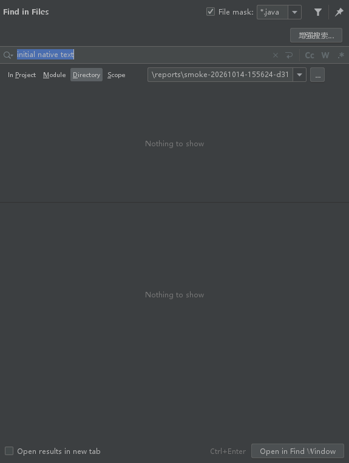
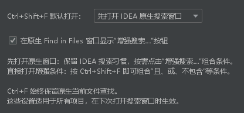
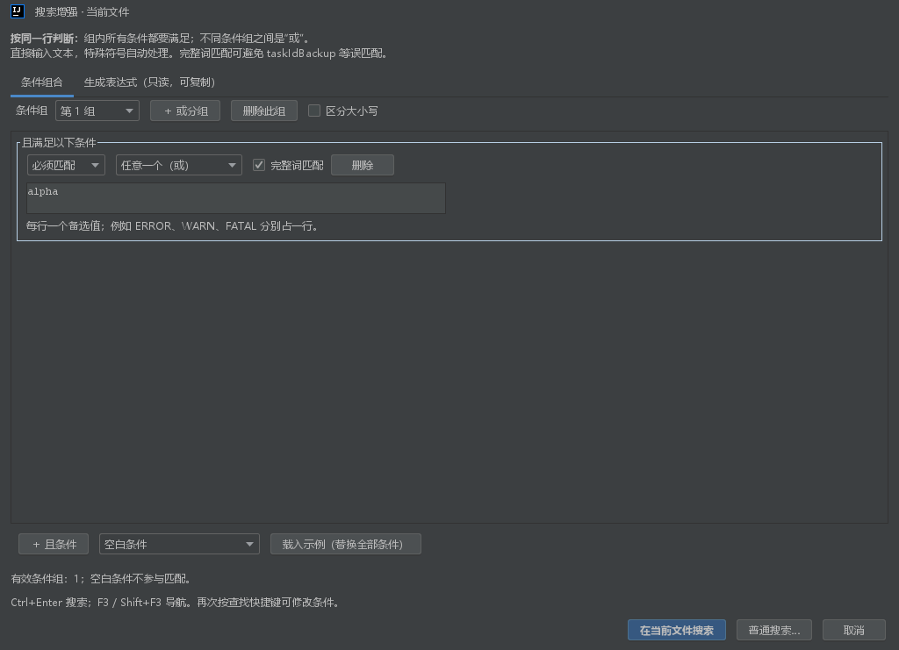

# Search Enhance：IDEA 搜索增强

通过界面组合“且、或、不包含”等条件，无需手写正则表达式。针对 **IntelliJ IDEA 2023.3.8，build 233.15619.7，Java 17** 开发，插件兼容范围限定为 `233.15619.7` 至 `233.*`。

## 安装

1. 构建后取得 `build/distributions/search-enhance-1.0.2.zip`，不需要解压。
2. IDEA：`Settings → Plugins → 齿轮 → Install Plugin from Disk…`，选择 ZIP。
3. 重启 IDEA。

不需要额外服务、账号、网络权限或数据库。构建、搜索均可离线进行。

## 使用

- **Ctrl+F**：保持 IDEA 原生当前文件查找，直接打开原生查找条。
- **Ctrl+Shift+F**：默认直接打开原生 **Find in Files**；点击窗口中的 **增强搜索…** 才进入条件组合。确认后回写当前原生窗口，保留 Scope、Directory、File mask，再回车打开原生 **Find** 结果窗口。
- **F3 / Shift+F3**：保持 IDEA 原生的下一处／上一处导航。
- 条件编辑器内 **Ctrl+Enter** 确认搜索，多值输入框中 Enter 换行。
- `Tools → 搜索增强：当前文件条件搜索…`：在当前文件组合条件，不绑定 Ctrl+F。
- `Tools → 搜索增强：编辑条件…`：有主编辑器时编辑当前文件条件，否则编辑项目搜索条件。
- **普通搜索…**：临时进入原来普通的 IDEA 查找，不需要卸载插件。

插件通过 `FindInPath` 动作读取默认入口偏好，沿用其已有快捷键，包括用户自定义 Keymap。`Find` 动作及 Ctrl+F 完全交给 IDEA。卸载或禁用插件并重启后恢复所有原生动作。

1.0.1 修复了“普通搜索…”可能执行 IDEA 延迟加载动作占位对象而不打开窗口的问题；升级时在 Plugins 中从磁盘安装新版 ZIP 并重启。修复依据和变更清单见 [修复记录](docs/FIX_1.0.1.md)。

### 设置

打开 **Settings → Tools → 搜索增强**：

- **Ctrl+Shift+F 默认打开**：选择“先打开 IDEA 原生搜索窗口”（默认），或“直接打开增强条件窗口”。
- **在原生 Find in Files 窗口显示“增强搜索…”按钮**：默认勾选，可取消以保留纯原生窗口。

设置适用于所有项目，应用后在下次打开搜索窗口时生效。Ctrl+F 始终为原生当前文件查找。入口偏好保存在 IDEA 用户配置 `options/SearchEnhancePreferences.xml` 中，搜索条件草稿仍按项目独立保存。

从原生窗口切换到增强模式时，当前普通文本会作为一个文本条件带入；确认后更新原生查询，取消或点击“普通搜索…”则返回原窗口。原生已有正则不会自动反向解析为条件组。

1.0.2 的界面流程、设置项和验证记录见 [功能说明](docs/FEATURE_1.0.2.md)。





### 组合规则

所有条件默认判断**同一行**，与参考速查表一致：

- **同一组中的条件是“且”**。每一行可以选择“必须匹配”或“不能匹配”。
- **不同组之间是“或”**，任意一组满足即可。
- **任意一个（或）**场景允许每行输入一个备选值，逗号等标点仍按原文搜索。
- **完整词匹配**默认开启，可逐条件关闭。例如 `taskId` 不会误命中 `taskIdBackup`、`taskId123`、`taskId_backup`。
- **区分大小写**作用于本次所有条件。

例如 `(ERROR 或 WARN) 且不包含 ignored`：

1. 添加“必须匹配 → 任意一个（或）”，输入 `ERROR` 和 `WARN`，分别占一行。
2. 添加“不能匹配 → 包含文本”，输入 `ignored`。

例如 `(taskId 且 ERROR) 或 (userId 且 update)`：建立两个条件组，各组分别添加两个“必须匹配 → 包含文本”。

条件编辑器记住当前项目的最后草稿，包括取消时尚未完成的内容，保存在本地 `.idea/workspace.xml`；不会写入项目共享配置。首次打开时可从编辑器的单行选区填入首个条件。日志只记搜索入口、分组数量等流程信息，不记录输入的关键词。

### 支持的场景

包含文本、任意一个、顺序出现、行首、行尾、紧邻文本、仅空白间隔、`字段 = 值`、`字段 == 值`、连续数字、变量前缀、方法调用形式、双引号字符串包含、完整标识符排除 `.成员`。可在界面载入可编辑的常用示例。

详见 [参考速查表场景对应说明](docs/SCENARIOS.md)。界面提供可选的只读表达式页，日常使用无需打开。



## 本机离线构建

在 PowerShell 中执行：

```powershell
.\scripts\build.ps1
```

指定 SDK / JDK：

```powershell
.\scripts\build.ps1 -IdeaHome 'D:\application\IntelliJ IDEA 2023.3.8' -JavaHome 'D:\application\sdk\jdk17'
```

脚本直接使用本机 SDK，逐 Java 文件执行 `javac --release 17` 检查，运行独立回归测试，生成标准插件 ZIP。**不使用 Maven，不下载 IDEA SDK，不改动当前运行的 IDEA**。

项目也提供 Gradle Wrapper 和 Java 构建配置，便于在 IDEA 导入。首次使用 Wrapper 需要下载对应 Gradle；本机离线交付以 PowerShell 脚本为准。Gradle 的 SDK 路径可通过 `-PideaHome=...` 或 `IDEA_HOME` 覆盖，默认使用本次确认的 IDEA 安装目录。

## 独立沙箱

```powershell
.\scripts\run-sandbox.ps1 -ProjectPath $PWD.Path
```

每次创建独立的 config、system、plugins、log 目录，不向现有 IDEA 用户配置中安装插件。加 `-PrepareOnly` 只准备目录，不启动 IDE。沙箱放在忽略的 `build/sandbox/` 下。

自动平台集成检查：

```powershell
.\scripts\smoke-test.ps1
```

它使用单独的测试插件在独立 IDEA 233 进程内检查动作覆盖、快捷键、原生查找、14 种真实 Swing 条件编辑器、原生按钮往返、范围/文件过滤保留和设置页注册，生成界面截图及报告后退出。测试入口不包含在正式安装包中。

## 实现及边界

界面只负责条件、字面值转义和查询生成；实际搜索、范围、文件类型过滤、取消、结果定位继续由 IDEA 提供，不另建全项目扫描器或索引。组合查询高亮**满足条件的整行**，便于在原生结果窗口阅读 AND / NOT 的上下文。

- 不跨行组合 A、B；同文件不同位置的交集不在本版范围内。
- 行首、行尾判断严格保留空格；水平空白模板不会跨行。
- 完整词边界识别 Unicode 字母、数字、组合符和连接符，对中文标识符也有效。
- 数字模板判断完整连续数字的长度。例如固定 6 位不会匹配 7 位数字中的 6 位子串。
- 方法调用和双引号字符串模板属于文本模式，不能替代 Java PSI 的语义查找；方法名后接 `(` 的声明形式也可能命中。
- 仅排除条件允许匹配空行；全部空白条件不能执行搜索。
- 原生 Find in Files 预览数量、超大文件处理及搜索范围限制沿用 IDEA 行为。
- `ActionManagerImpl.getBaseAction`、延迟动作实例化和动作覆盖机制按 233 平台核实；不宣称兼容未验证的其他 IDEA 大版本。

实现参考：[JetBrains 233 原生项目搜索入口](https://github.com/JetBrains/intellij-community/blob/idea/233.15619.7/platform/lang-impl/src/com/intellij/find/findInProject/FindInProjectManager.java)、[233 原生编辑器查找条](https://github.com/JetBrains/intellij-community/blob/idea/233.15619.7/platform/lang-impl/src/com/intellij/find/EditorSearchSession.java)。

开发变更分类见 [CHANGE_REVIEW.md](docs/CHANGE_REVIEW.md)，1.0.2 验证结果见 [FEATURE_1.0.2.md](docs/FEATURE_1.0.2.md)，首次交付记录见 [VALIDATION.md](docs/VALIDATION.md)。
